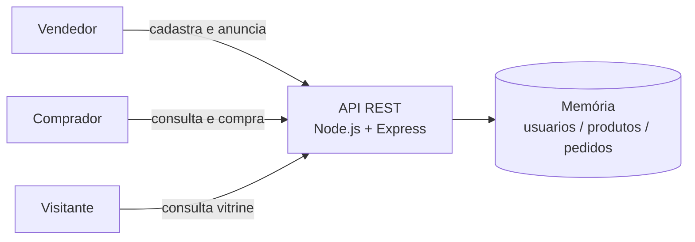
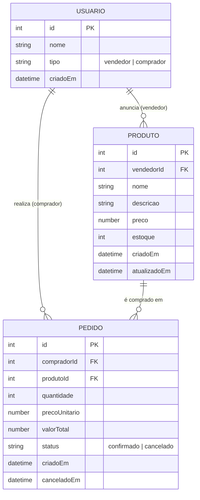
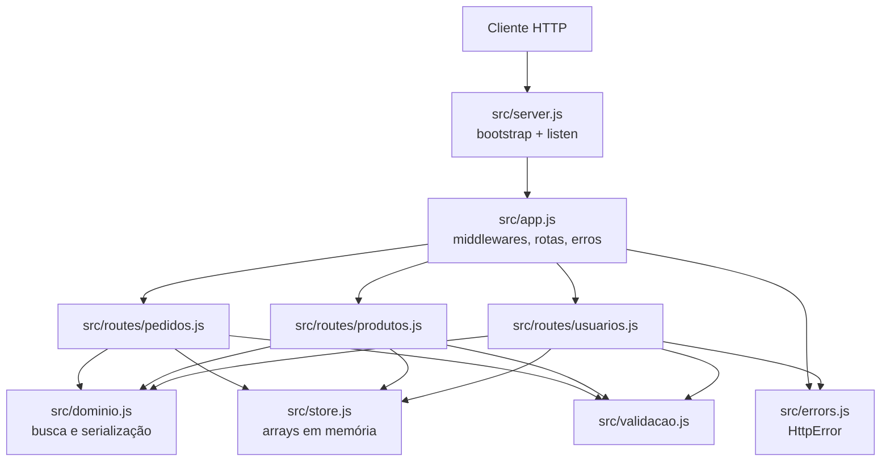
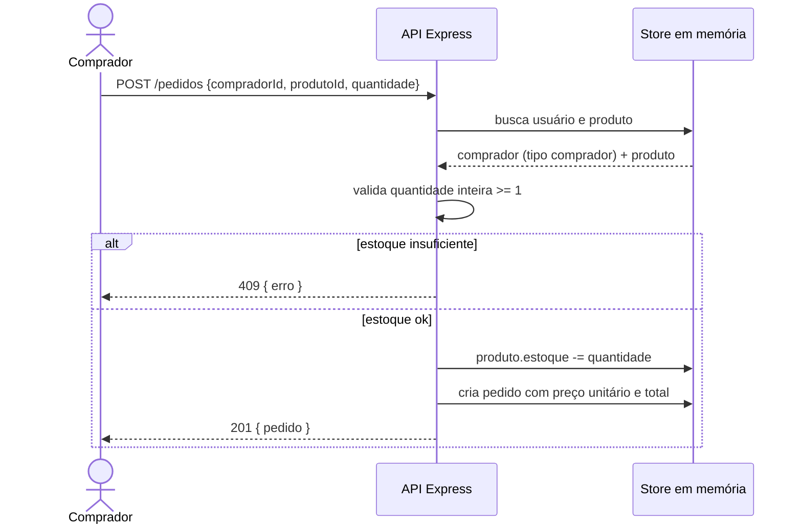

# Visão geral do sistema — Marketplace em memória

## 1. Objetivo

Construir um **marketplace simplificado** para exercitar, de ponta a ponta, o fluxo de
**cadastro de vendedores → anúncio de produtos → compra por compradores**, usando
**Node.js + Express** com **armazenamento em memória** (sem banco de dados).

O foco é didático: a API sobe em segundos, não exige infraestrutura e permite testar
as regras de negócio com `curl`, Postman ou testes automatizados. A persistência é
descartável — ao reiniciar o processo, os dados somem.

---

## 2. Atores

| Ator | Descrição |
|---|---|
| **Vendedor** | Cadastra-se, anuncia produtos, gerencia preço/estoque dos próprios anúncios e acompanha pedidos recebidos. |
| **Comprador** | Cadastra-se, consulta a vitrine, realiza compras e pode cancelar os próprios pedidos. |
| **Visitante** | Consumidor da API que apenas consulta a vitrine e os detalhes dos produtos (sem autenticação nesta versão). |

> No modelo atual, `vendedor` e `comprador` são tipos **exclusivos** de usuário.
> Um mesmo usuário não acumula os dois papéis.

---

## 3. Visão de contexto



O sistema é um **monólito**: uma única aplicação Express expõe a API REST e mantém o
estado em memória. Não há banco, cache externo, fila ou serviço de terceiros.

---

## 4. Requisitos funcionais

| Código | Requisito |
|---|---|
| RF01 | Cadastrar usuário como `vendedor` ou `comprador`. |
| RF02 | Listar usuários, com filtro opcional por tipo. |
| RF03 | Consultar usuário por ID. |
| RF04 | Anunciar produto (somente `vendedor`). |
| RF05 | Listar a vitrine (somente produtos com estoque > 0, por padrão). |
| RF06 | Consultar detalhes de um produto. |
| RF07 | Atualizar nome, descrição, preço ou estoque (somente o vendedor dono). |
| RF08 | Realizar compra (somente `comprador`), baixando o estoque. |
| RF09 | Listar pedidos, com filtros por comprador, vendedor e status. |
| RF10 | Consultar pedido por ID. |
| RF11 | Cancelar pedido (somente o comprador dono), devolvendo o estoque. |

### Fora do escopo desta parte

Autenticação real, persistência em banco, paginação, upload de imagens, carrinho com
múltiplos itens, pagamento, frete, cupons e painel web.

---

## 5. Regras de negócio

| Código | Regra |
|---|---|
| RN01 | `nome` do usuário: texto de 2 a 120 caracteres (após `trim`). |
| RN02 | `tipo` do usuário deve ser exatamente `vendedor` ou `comprador`. |
| RN03 | Apenas usuários do tipo `vendedor` podem criar/editar produtos. |
| RN04 | Apenas o vendedor dono do anúncio pode alterá-lo. |
| RN05 | `preco` deve ser um número finito maior que zero, com 2 casas decimais. |
| RN06 | `estoque` deve ser um inteiro entre 0 e 1.000.000. |
| RN07 | Produto com estoque 0 não aparece na vitrine padrão (`?todos=true` mostra). |
| RN08 | Apenas usuários do tipo `comprador` podem comprar. |
| RN09 | `quantidade` deve ser um inteiro entre 1 e 10.000. |
| RN10 | Não é possível comprar mais do que o estoque disponível (HTTP 409). |
| RN11 | O pedido guarda o **preço unitário no momento da compra** (snapshot). |
| RN12 | `valorTotal = precoUnitario × quantidade`, arredondado a 2 casas. |
| RN13 | Somente o comprador dono pode cancelar; pedido cancelado não pode ser cancelado de novo. |
| RN14 | Cancelar um pedido devolve a quantidade ao estoque do produto. |
| RN15 | Toda resposta de erro é JSON no formato `{ "erro": "..." }`. |

---

## 6. Modelo de domínio



Observações de modelagem:

- **IDs monotônicos por coleção** (`proximoId`), e não `array.length + 1`, para não
  reaproveitar identificadores.
- **Snapshot do preço** no pedido: alterações posteriores no anúncio não reescrevem
  o histórico.
- **Dinheiro em reais** com arredondamento explícito (`arredondarDinheiro`). Em um
  sistema real, o recomendado é armazenar **centavos inteiros**.
- Status do pedido limitado a `confirmado` e `cancelado`.

---

## 7. Arquitetura

Monólito modular, com separação simples de responsabilidades:



| Camada | Arquivo | Responsabilidade |
|---|---|---|
| Bootstrap | `src/server.js` | Porta, log inicial e encerramento gracioso. |
| Aplicação | `src/app.js` | JSON parser, health check, montagem das rotas, 404 e erro centralizado. |
| Rotas | `src/routes/*.js` | Contrato HTTP, validação de entrada, regras de negócio e status codes. |
| Domínio | `src/dominio.js` | Busca de entidades, garantia de existência/tipo e serialização de saída. |
| Persistência | `src/store.js` | Arrays em memória, contadores de ID e reset para testes. |
| Validação | `src/validacao.js` | Conversão e validação de textos, IDs, inteiros, números e filtros. |
| Erros | `src/errors.js` | `HttpError` com status HTTP associado. |

O fluxo de uma requisição é sempre:
**rota → validação → regra de negócio → store → serialização → resposta JSON**.
Qualquer `HttpError` lançado no caminho é convertido pelo middleware de erro no
status e no corpo adequados.

---

## 8. API REST

Base local: `http://localhost:3000`

| Método | Rota | Descrição | Sucesso | Principais erros |
|---|---|---|---|---|
| GET | `/health` | Verifica se o serviço está no ar. | 200 | — |
| POST | `/usuarios` | Cadastra vendedor ou comprador. | 201 | 400 |
| GET | `/usuarios` | Lista usuários (`?tipo=`). | 200 | 400 |
| GET | `/usuarios/:id` | Detalha usuário. | 200 | 400, 404 |
| POST | `/produtos` | Anuncia produto. | 201 | 400, 403, 404 |
| GET | `/produtos` | Vitrine (`?todos=true&q=&vendedorId=`). | 200 | 400 |
| GET | `/produtos/:id` | Detalha produto. | 200 | 400, 404 |
| PATCH | `/produtos/:id` | Atualiza anúncio (dono). | 200 | 400, 403, 404 |
| POST | `/pedidos` | Realiza compra. | 201 | 400, 403, 404, 409 |
| GET | `/pedidos` | Lista pedidos (`?compradorId=&vendedorId=&status=`). | 200 | 400 |
| GET | `/pedidos/:id` | Detalha pedido. | 200 | 400, 404 |
| POST | `/pedidos/:id/cancelar` | Cancela e devolve estoque. | 200 | 400, 403, 404, 409 |

### Formato dos erros

```json
{ "erro": "Estoque insuficiente para \"Caneca\". Disponível: 1." }
```

| Status | Uso |
|---|---|
| 400 | Payload/query inválidos (campo ausente, tipo errado, JSON malformado). |
| 403 | Usuário existe, mas não tem o papel exigido (ou não é o dono). |
| 404 | Recurso inexistente ou rota desconhecida. |
| 409 | Conflito de estado (estoque insuficiente, pedido já cancelado). |

---

## 9. Fluxo principal: compra de um produto



Em caso de cancelamento (`POST /pedidos/:id/cancelar`), o caminho é inverso:
valida o dono e o status, devolve `quantidade` ao estoque e marca o pedido como
`cancelado`.

---

## 10. Decisões de projeto

1. **Memória como banco** — simplicidade e feedback imediato; custo: perda de dados
   ao reiniciar, sem isolamento entre execuções e sem escala horizontal.
2. **Validação na borda** — toda entrada passa por `validacao.js`; nada chega às
   regras de negócio com tipo inesperado. Comparações com `NaN` e coerções
   implícitas foram eliminadas (o bug clássico de `quantidade: "abc"`).
3. **Erros centralizados** — rotas lançam `HttpError`; um único middleware decide o
   status e garante JSON, inclusive para JSON malformado e rotas inexistentes.
4. **Serialização explícita** — as respostas são montadas em `dominio.js` e não
   expõem campos internos desnecessários.
5. **Operação síncrona** — a checagem "estoque suficiente → baixa" é atômica em
   memória porque não há `await` no meio. Com banco assíncrono, seria necessário
   transação ou `UPDATE ... WHERE estoque >= ?`.
6. **Testes de API** com o test runner nativo do Node (`node --test`) e `fetch`,
   sem dependências extras.

---

## 11. Limitações conhecidas e evolução (Parte 2)

- **Sem autenticação/autorização real**: a identidade é declarada no corpo
  (`compradorId`, `vendedorId`). Qualquer cliente pode se passar por outro usuário.
  Evolução: login (JWT/sessão) e derivar o ator do token.
- **Sem persistência**: migrar para PostgreSQL/MongoDB, mantendo as rotas e
  criando uma camada de repositório.
- **Sem transações**: ao usar banco, envolver baixa de estoque + criação do pedido
  em transação e tratar concorrência.
- **Sem paginação/ordenação** na vitrine e nos pedidos.
- **Sem carrinho**: cada pedido representa um único produto.
- **Sem idempotência**: repetir `POST /pedidos` cria um novo pedido (poderia usar
  `Idempotency-Key`).
- **Sem observabilidade**: logs estruturados, métricas e health check mais rico.
- **Sem front-end**: a API é o produto desta parte.

---

## 12. Como executar

```bash
pnpm install
pnpm start          # http://localhost:3000
pnpm dev            # modo watch
pnpm test           # testes de API (node --test)
```

Variável opcional: `PORT` (padrão `3000`).

### Fluxo completo com curl

```bash
# 1. vendedor
curl -s -X POST localhost:3000/usuarios \
  -H 'Content-Type: application/json' \
  -d '{"nome":"Loja da Ana","tipo":"vendedor"}'

# 2. comprador
curl -s -X POST localhost:3000/usuarios \
  -H 'Content-Type: application/json' \
  -d '{"nome":"Bruno","tipo":"comprador"}'

# 3. produto do vendedor 1
curl -s -X POST localhost:3000/produtos \
  -H 'Content-Type: application/json' \
  -d '{"vendedorId":1,"nome":"Caneca","descricao":"Cerâmica","preco":19.90,"estoque":10}'

# 4. vitrine
curl -s localhost:3000/produtos

# 5. compra do comprador 2 (2 unidades)
curl -s -X POST localhost:3000/pedidos \
  -H 'Content-Type: application/json' \
  -d '{"compradorId":2,"produtoId":1,"quantidade":2}'

# 6. lista de pedidos
curl -s localhost:3000/pedidos

# 7. cancelamento do pedido 1
curl -s -X POST localhost:3000/pedidos/1/cancelar \
  -H 'Content-Type: application/json' \
  -d '{"compradorId":2}'
```

---

## 13. Estrutura de arquivos

```text
.
├── package.json
├── pnpm-lock.yaml
├── README.md
├── OVERVIEW.md              ← este documento
├── src/
│   ├── app.js               # Express: middlewares e montagem das rotas
│   ├── server.js            # bootstrap e listen
│   ├── store.js             # arrays em memória + IDs
│   ├── dominio.js           # busca, regras de existência e serialização
│   ├── validacao.js         # validação/conversão de entrada
│   ├── errors.js            # HttpError
│   └── routes/
│       ├── usuarios.js
│       ├── produtos.js
│       └── pedidos.js
└── tests/
    └── api.test.js          # 10 testes de integração da API
```
